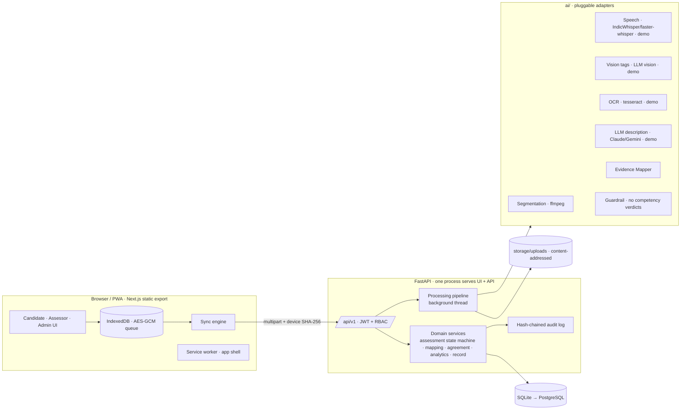

# Architecture

Kaushal Pramaan is a **traceable evidence-intelligence layer** on the existing RPL workflow (NCVET
guidelines [1], NQR QP→NOS→PC [4]). It does not replace registration, assessment agencies, assessors or
certification. It adds PC-level linking, an assessor-first workspace, an audit trail and an agreement
measure.

```
 Candidate ──► Assessment Agency ──► Assessor ──► Awarding Body ──► Existing certification ecosystem
 └────────────── OUR LAYER: capture · link to PC · surface evidence · audit trail ──────────────┘
```

## System diagram



## Layers and boundaries

| Layer | Location | Responsibility | Must not |
|---|---|---|---|
| UI | `frontend/src/app/*` | Screens; no business rules beyond display | Decide anything the server must enforce |
| Client domain | `frontend/src/lib/*` | API client, auth session, offline queue, sync | Talk to the network outside `lib/api.ts` |
| API | `backend/app/api/routers/*` | HTTP, validation (Pydantic), authN/Z | Contain business logic |
| Services | `backend/app/services/*` | State machine, mapping, agreement, audit, records, pipeline | Know about HTTP |
| AI | `ai/*` | Adapters behind interfaces; guardrail; demo provider | Produce scores or competency verdicts |
| Data | `backend/app/models/*`, `backend/alembic/` | Relational model + migrations | — |
| Storage | `storage/` | Evidence files named by SHA-256; demo media | Use client-supplied paths |

## Key invariants (and where they are enforced)

1. **Assessor-first.** `opened → initial_locked → ai_revealed → finalized` in the assessment service. The
   API returns `409` for AI support before the initial score, and for any change to a locked score. The UI
   merely reflects this.
2. **Two tiers of AI output.** Tier 1 (*where*: segment + PC) is visible before scoring. Tier 2 (confidence,
   signal, explanation, tags) is gated per viewer in the mapping and assessment services.
3. **AI never scores.** The guardrail scrubs competency language. AI schemas have no score field.
4. **Blind double-scoring.** Assessment payloads never include another assessor's score; pairs are visible
   only to admins.
5. **Traceability.** Every state change writes an audit entry whose hash chains to the previous one.
6. **Honest modes.** Each AI step records `mode = real | demo | unavailable`, and the UI badges it.
7. **No unmeasured numbers.** κ and impact metrics are `null` below their minimum n, and the UI says
   *Pilot measurement underway*.

## Scalability

Nothing is hard-coded to PC10. Qualifications, NOS, PCs, rubrics (versioned), agencies and assessors are
data. PC10 / Evidence #17 / A-07 exist only as **seed data**. The mapper ranks every PC in the evidence's
qualification. Moving SQLite → PostgreSQL is a `DATABASE_URL` change. pgvector-based semantic mapping and a
real job queue (e.g. RQ/Celery) are the next steps for volume.

## Folder structure

```
kushal-praman/
├─ frontend/                 Next.js 16 (static export) PWA
│  ├─ src/app/               routes: /, login, register, candidate, assessor/{workspace,mapper,assess}, trace,
│  │                         admin/*, research, status, jury
│  ├─ src/components/        ui kit, shell, candidate/, assessor/, audit, agreement, metrics, chain-hero
│  ├─ src/lib/               api client, auth, types, format, hooks, i18n, offline/{crypto,store,sync,useSync}
│  └─ public/sw.js           app-shell service worker
├─ backend/
│  ├─ app/                   main, config, db, models/, schemas/, api/routers/, services/, security/
│  ├─ alembic/               migrations
│  └─ tests/                 pytest (unit + API + integration)
├─ ai/                       adapters (segmentation, speech, vision, ocr, llm), mapper, guardrails, demo provider, fixtures/
├─ database/seed/            qualification JSON (PC10 verbatim), research references JSON
├─ storage/                  uploads/ (runtime) · demo/practical_demo.mp4 (synthetic)
├─ scripts/                  setup.ps1, run.ps1, make_demo_video.py
└─ docs/                     PLAN, ARCHITECTURE, API, DATABASE, AI, OFFLINE, RESEARCH, DEMO, SECURITY
```

## Deployment

- **Finale/demo:** one FastAPI process serves `frontend/out` and `/api/v1` on port 8000. No Docker, no
  external calls in demo mode.
- **Production path (as in the deck's stack):** PostgreSQL (+ pgvector), object storage for media,
  a worker queue for processing, IndicWhisper on a GPU worker, HTTPS with HSTS, Docker images. These
  are documented targets, not built in the MVP.
