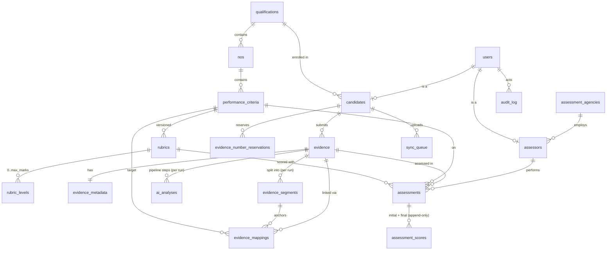

# Database

SQLAlchemy 2.0 models (`backend/app/models/*`) with Alembic migrations
(`backend/alembic/versions/0001_initial_schema.py`, 20 tables). SQLite by default, PostgreSQL via
`DATABASE_URL`.

```bash
.venv/Scripts/python -m alembic -c backend/alembic.ini upgrade head
```
Migrate.

```bash
.venv/Scripts/python -m backend.app.services.seed
```
Seed (idempotent).

## ER diagram


`research_references` is standalone and served to `/research`.

## Tables

| Table | Key columns | Notes |
|---|---|---|
| `users` | email (unique), password_hash (bcrypt), role, is_active, last_login_at | One login per person; role ∈ candidate/assessor/admin |
| `candidates` | user_id, candidate_code, qualification_id, preferred_language, district, **next_evidence_number** | Sequence allocated atomically (`services/sequence.py`) |
| `assessors` | user_id, assessor_code (e.g. A-07), agency_id | |
| `assessment_agencies` | name, code | Multi-agency ready |
| `qualifications` | title, **nqr_code**, nsqf_level, sector_skill_council, version, assessment_mode, source_ref | From the NQR Q-File [4] |
| `nos` | qualification_id, code (ISC/N1002), title, version, is_mandatory, sort_order | |
| `performance_criteria` | nos_id, code (PC10), **text (verbatim)**, is_verbatim, source_note, max_marks, keywords (JSON) | Keywords feed the lexical mapper |
| `rubrics` / `rubric_levels` | pc_id, **version**, status draft/validated, author_note / score, descriptor, exemplar | New version per edit; assessments pin `rubric_id` |
| `evidence` | candidate_id, display_number, kind, stored_filename (`<sha256>.<ext>`), sha256, client_sha256, **integrity_ok**, **local_id** (idempotency), status, is_demo, offline_captured, encrypted_at_rest, captured_at, synced_at, processing_run | |
| `evidence_metadata` | latitude, longitude, accuracy_m, device, language, queued_at, sync_attempts, duration_s, width, height, codecs | ffprobe fills the media fields |
| `evidence_number_reservations` | candidate_id, number (unique per candidate), used | Numbers reserved for offline devices |
| `evidence_segments` | evidence_id, run, idx, start_s, end_s, label, source (scene/window/mapping) | |
| `ai_analyses` | evidence_id, run, seq, key, status, **mode real/demo/unavailable**, provider, model, detail, output (JSON) | One row per pipeline step per run |
| `evidence_mappings` | evidence_id, segment_id, pc_id, statement, signal, **confidence**, rationale, tags, mode, **status pending/confirmed/edited/rejected**, decided_by_id, decision_reason | Tier-2 fields are gated per viewer |
| `assessments` | evidence_id, pc_id, assessor_id, candidate_id, rubric_id, **status**, opened_at, **initial_locked_at**, **ai_revealed_at**, finalized_at, final_rationale, blind, is_second_assessor, is_demo | State machine opened → initial_locked → ai_revealed → finalized |
| `assessment_scores` | assessment_id, **phase initial/final**, score, max_score, created_at | Append-only; the initial row is never updated |
| `audit_log` | ts, actor_id, action, entity_type, entity_id, summary, details, **prev_hash, hash** | SHA-256 chain; `/audit/verify` recomputes it |
| `sync_queue` | candidate_id, local_id, evidence_id, status synced/failed, attempts, offline_captured, is_demo, last_error | Basis of the offline-sync-success metric |
| `research_references` | number, short, citation, url, doi, category, what_it_says, design_decision, where_in_product | Loaded from `database/seed/research_references.json` |

## Integrity rules

- The initial score is written once (`assessment_scores.phase='initial'`). Re-submission → 409.
- `final_rationale` is required when final ≠ initial (422).
- `evidence.local_id` makes uploads idempotent. `(candidate_id, number)` is unique in reservations.
- Demo vs pilot: `is_demo` on evidence, assessments and sync rows keeps demo sessions out of pilot metrics.

## Seed data (`database/seed/`)

- `qualification_assistant_electrician.json`: QP QG-03-IS-03883-2025-V2-IISSSC, NSQF 3, six NOS.
  **Only ISC/N1002 PC10 has a PC** (verbatim from the Q-File, original spelling). The PC10 rubric is a
  **team draft** (`status=draft`).
- `research_references.json`: the 10 deck references with their design decisions.
- Demo users, agency and Raj Kumar's evidence counter (starts at 17) are in `backend/app/services/seed.py`.

## Scaling notes

Everything is data, so new QPs, NOS, PCs, agencies and assessors need no code changes. For volume:
PostgreSQL (+ pgvector for semantic mapping), media in object storage, the pipeline on a job queue,
and a database-level advisory lock for the audit chain when running several workers.
