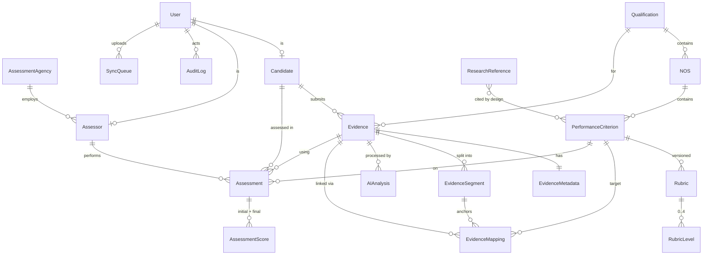

# Kaushal Pramaan — Build Plan (SIH26242 · Team AQUILA123)

> Working product name taken from the earlier deck title (`KaushalPramaan`). Rename freely.
> Source of truth: `AQUILA123_2026.pdf` (6 slides) + speaker notes in `AQUILA123_SIH2026_RPL_final.pptx`.

**One sentence:** a traceable evidence-intelligence layer that sits on top of the existing RPL
workflow and links *existing* evidence to the exact NQR Performance Criterion it supports, with
the assessor scoring before any AI interpretation is shown.

```
EVIDENCE → PERFORMANCE CRITERION → HUMAN ASSESSMENT → RECOGNITION
AI finds the evidence. The assessor decides what it means.
```

---

## 0. Facts pinned from the deck (do not drift from these)

| Item | Value | Source |
|---|---|---|
| QP | Assistant Electrician | [4] |
| NQR code | QG-03-IS-03883-2025-V2-IISSSC | [4] |
| NSQF | Level 3 | [4] |
| Assessment mode (official) | Offline | [4], slide 4 |
| NOS | ISC/N1002 — *Assemble the electrical components* | [4] (title confirmed via NQR listing) |
| PC10 (verbatim, original spelling) | "use wires strippers, crippling tool and other insulated tools for making the electrical connections of machine/electrical panels" | [4], speaker notes slide 2 |
| Rubric | 4 marks, PC-level | slide 3 |
| Demo | Evidence #17 · 10:00 video · AI surfaced 00:42–01:08 · initial 3/4 · AI "supports" · final 3/4 · Assessor A-07 · 14:32 IST | slides 2–3, notes |
| κ | **Pilot measurement underway** — no value claimed | slide 6 |
| Output | Assessment record → Awarding Body certifies → DigiLocker (**existing ecosystem, not integrated**) | slide 3, notes |

**Gaps I will NOT fill with invented content:**
- Other PC texts of ISC/N1002 and other NOS: not in the deck. Seed contains only PC10 verbatim; the
  remaining NOS are seeded by code/title with **no PCs**, and admin can add PCs from the Q-File.
- Rubric level descriptors (0–4) are **team-drafted**, marked `status = draft — to be validated with
  SSC-certified assessors`. The deck sources the *use* of rubrics [8], not these exact descriptors.
- The 10-minute video: no real recording exists in the repo. A **synthetic placeholder** video
  (timecode + captions, clearly watermarked `SYNTHETIC DEMO MEDIA`) is generated with ffmpeg.
  **Replace it with a real recorded practical before the finale** (`docs/DEMO.md` explains how).

---

## 1. Product architecture

Three user surfaces on one platform. The core sits in the middle and is the reason the product exists.

```
 CANDIDATE (PWA, offline-first)      EVIDENCE INTELLIGENCE (server)        ASSESSOR WORKSTATION
 ─────────────────────────────       ──────────────────────────────        ─────────────────────
 capture video/photo/voice/doc  ──►  integrity (SHA-256 re-verify)   ──►   Evidence Workspace
 timestamp · geotag · hash           segmentation (ffmpeg scenes)          Evidence Mapper  ◄── core
 encrypted local queue (IDB)         speech-to-text (Indic ASR adapter)    Assessor-first scoring
 auto-sync + visible queue           OCR · vision tags · LLM summary       AI reveal (after lock)
                                     EVIDENCE MAPPER: evidence→NOS→PC      Final decision + rationale
                                     guardrail: no competency language     Audit trail · record export

 ADMIN / ASSURANCE:  QP·NOS·PC·rubric management · users · agreement (weighted κ) · impact metrics ·
                     tamper-evident audit log · research basis · system health · Jury mode
```

**Two tiers of AI output (key design decision):**

| Tier | Content | When the assessor sees it | Why |
|---|---|---|---|
| 1. Retrieval | *Where* evidence is: segment 00:42–01:08, linked PC10 | Before scoring | This is the time saving: no scrubbing through 10 minutes. It points; it does not interpret. |
| 2. Interpretation | Confidence, "supports" signal, tags, explanation, transcript highlights | **Only after the initial score is locked** | Anti-anchoring, per Buçinca et al. [5]: explanations alone don't prevent over-reliance. |

The **API** enforces this, not only the UI. `GET /assessments/{id}/ai-support` returns `409` until an
initial score exists. The initial score is immutable (`409` on a re-submit). A judge can try it in
Swagger.

**Modes:**
- `REAL` runs only the services actually available (ffmpeg always; ASR, OCR and LLM only when
  installed or configured). An unavailable service is reported as `skipped: unavailable`, never faked.
- `DEMO` is real ffmpeg and hashing, plus **seeded deterministic analysis only for the known demo
  media** (matched by SHA-256). Every seeded result is labelled `DEMO ANALYSIS`. No external network
  calls, so it survives a dead network or a dead API.

---

## 2. System architecture

```mermaid
flowchart LR
  subgraph Browser["Browser / PWA (Next.js static export)"]
    SW[Service Worker\napp-shell cache]
    IDB[(IndexedDB\nAES-GCM encrypted\nevidence queue)]
    UI[Candidate · Assessor · Admin UI]
    SYNC[Sync engine\nonline/offline + retry]
    UI --> IDB --> SYNC
  end
  subgraph Server["FastAPI (single process, serves UI + API)"]
    API[REST API /api/v1\nJWT + RBAC]
    SVC[Domain services\nassessment · mapping · agreement · audit]
    PIPE[Processing pipeline\nbackground worker]
    AUD[Hash-chained audit log]
  end
  subgraph AI["ai/ package (pluggable adapters)"]
    SEG[Segmentation\nffmpeg scene detect]
    ASR[Speech\nIndicWhisper/faster-whisper | demo]
    OCR[OCR\ntesseract | LLM vision | demo]
    VIS[Vision tags\nLLM vision | demo]
    LLM[LLM summarise/explain\nClaude/Gemini | demo]
    MAP[Evidence Mapper\nlexical baseline + LLM rerank]
    GRD[Guardrail\nno competency verdicts]
  end
  DB[(SQLite dev / PostgreSQL prod\nSQLAlchemy + Alembic)]
  FS[(storage/\nuploads by sha256)]
  SYNC -- HTTPS multipart + client hash --> API
  API --> SVC --> DB
  SVC --> AUD --> DB
  API --> PIPE --> AI
  PIPE --> FS
  AI --> GRD
```

**Deployment for the finale:** one command starts FastAPI, which serves the built static UI and the
API on `http://localhost:8000`. One process, no CORS and no Docker dependency. Docker and Postgres are
documented as the production path, matching the deck's stated stack. pgvector is the planned upgrade
for semantic mapping; the MVP uses a dependency-free lexical baseline and says so.

---

## 3. Database ER structure



Key columns (full detail in `DATABASE.md`):
- `Evidence`: display_number (per-candidate, reserved for offline devices), kind, sha256 (server),
  client_sha256, integrity_ok, local_id (idempotency key), status
  `received→processing→ready|failed`, is_demo
- `EvidenceMapping`: pc_id, segment_id, confidence (**uncalibrated relevance score**), rationale,
  mode `real|demo`, status `pending|confirmed|edited|rejected`, decided_by
- `Assessment`: status `opened→initial_locked→ai_revealed→finalized`, opened_at, ai_revealed_at,
  finalized_at, final_rationale (**required if final ≠ initial**), blind (double-scoring)
- `AssessmentScore`: phase `initial|final`, score, max_score, created_at (append-only)
- `AuditLog`: actor, action, entity, details JSON, `prev_hash`, `hash` (SHA-256 chain, tamper-evident,
  with a verify endpoint)

---

## 4. Frontend route map (Next.js static export; IDs via query string)

| Route | Role | Purpose |
|---|---|---|
| `/` | public | What it is in 30 s (the chain) + sign-in by role |
| `/login`, `/register` | public | Candidate/assessor registration; admin seeded |
| `/candidate` | candidate | Qualification → NOS → PC list, my evidence, **sync queue** |
| `/candidate/capture` | candidate | **SCREEN 1 — Evidence Capture** (video/photo/voice/doc, offline) |
| `/assessor` | assessor | Assessment queue |
| `/assessor/workspace?evidence=` | assessor | **SCREEN 2 — Evidence Workspace** (10:00 timeline, *Find relevant evidence*) |
| `/assessor/mapper?evidence=` | assessor/admin | **SCREEN 3 — Evidence Mapper** (animated, clickable chain) |
| `/assessor/assess?assessment=` | assessor | **SCREEN 4 — Assessor-first scoring** (lock → reveal → final) |
| `/trace?assessment=` | assessor/admin | **SCREEN 5 — Traceability** (audit trail, agreement, record PDF/JSON) |
| `/admin` + `/admin/{qualifications,users,evidence,assessments,audit,agreement,analytics}` | admin | Management + assurance |
| `/research` | all | Research & Design Basis (10 refs → design decisions) |
| `/status` | all | System health: DB, storage, ffmpeg, each AI adapter, mode |
| `/jury` | admin | Jury mode: 9 tiles, each 1 click; demo reset to any stage |

## 5. Backend API map (`/api/v1`, full contract in `API.md`)

| Area | Endpoints |
|---|---|
| Auth | `POST /auth/register` · `POST /auth/login` · `GET /auth/me` |
| Qualifications | `GET/POST /qualifications` · `GET /qualifications/{id}/tree` · `POST /nos` · `POST /pcs` · `PUT /pcs/{id}/rubric` |
| Evidence | `POST /evidence` (multipart, idempotent on local_id) · `GET /evidence` · `GET /evidence/{id}` · `GET /evidence/{id}/media` (range) · `POST /evidence/{id}/process` · `GET /evidence/{id}/processing` |
| Sync | `POST /sync/reserve` (evidence numbers for offline devices) · `GET /sync/status` |
| Mapping | `GET /evidence/{id}/mappings` (tier-gated) · `POST /mappings/{id}/confirm`, `/edit`, `/reject` |
| Assessments | `POST /assessments` (open) · `GET /assessments/{id}` · `POST /assessments/{id}/initial` · `GET /assessments/{id}/ai-support` (409 until locked) · `POST /assessments/{id}/final` · `GET /assessments/{id}/record.{json,pdf}` |
| Audit | `GET /audit` · `GET /audit/verify` |
| Agreement | `GET /agreement` (pairs, n, κ only if n ≥ threshold) |
| Analytics | `GET /analytics/impact` (4 metrics, each tagged `demo`/`pilot`, plus the post-reveal change rate) |
| Research | `GET /research` |
| System | `GET /health` · `POST /demo/reset?stage=` (admin, demo mode only) |

## 6. AI pipeline

```
upload ─► integrity: recompute SHA-256, compare to client hash ─► probe (ffprobe: duration, codec)
       ─► segmentation (ffmpeg scene-change + 30 s fallback windows)          [REAL always]
       ─► speech: ASR adapter → timestamped transcript, language id           [IndicWhisper | demo | skipped]
       ─► vision: keyframe tags (objects/actions) per segment                  [LLM-vision | demo | skipped]
       ─► OCR (photos/docs)                                                    [tesseract | LLM | demo | skipped]
       ─► LLM: neutral segment descriptions + summary (JSON schema)            [Claude/Gemini | demo | skipped]
       ─► MAPPER: score (segment × PC) on transcript+tags+description vs PC text/keywords
                  → top segments per PC, relevance score, rationale
       ─► GUARDRAIL: reject/neutralise any output containing a competency verdict
                     ("competent", "pass", "fail", "qualified", "certif*", score predictions)
```
Every AI output wording is evidential: *"Potential evidence supporting PC10 found at 00:42–01:08."*
The AI never produces a score.

## 7. Offline architecture

```
CAPTURE (MediaRecorder / file input) → SHA-256 of plaintext → encrypt AES-GCM (non-extractable key in IDB)
→ IndexedDB queue {local_id, reserved evidence #, metadata, geo, ts, ciphertext, status}
→ Sync engine: triggers = `online` event, app start, 20 s interval, manual "Sync now"
→ decrypt → multipart upload with client hash → server verifies hash → idempotent on local_id
→ server status polled: Synced → Processing → Ready for assessment
```
- **Evidence numbers while offline:** the device reserves a block of numbers when online, so
  "Evidence #17 · saved locally" is real, not a placeholder.
- **Honest scope:** the encryption protects the queue at rest from casual inspection. It does not
  protect against a fully compromised device. `OFFLINE.md` says so.
- **Demo:** the backend runs on localhost, so turning off Wi-Fi doesn't break localhost. A
  *Field-conditions: Offline* switch blocks the sync engine and is labelled as a simulation. Real
  `navigator.onLine` is also respected. For a truly offline demo, open the candidate app on a phone
  over HTTPS and switch on airplane mode (`DEMO.md`).

## 8. Research → design-decision matrix

| # | Source | What it supports | Design decision | Where it lives |
|---|---|---|---|---|
| 1 | NCVET (2023) RPL Guidelines | video + geotag evidence, PC-wise reporting | Build **on** existing evidence; geotag/timestamp/hash at capture; PC-wise record | Capture, record export |
| 2 | ILO (2026) doi:10.54394/00034676 | access barriers, inconsistent standards, assessor shortage | Offline capture near worksite; rubric + agreement for consistency; time-per-candidate metric | Offline, agreement, analytics |
| 3 | DigiLocker NAD | certificates already flow digitally | Record hands off to Awarding Body; DigiLocker shown as **existing, not integrated** | Record, Trace screen |
| 4 | NQR Q-File (2025) | official QP→NOS→PC | Use the official hierarchy; PC10 verbatim; no home-made ontology | Data model, Mapper |
| 5 | Buçinca et al. (2021) | explanations don't stop over-reliance | **Assessor-first**: interpretive AI locked until the initial score; server-enforced | Assess screen, API 409 |
| 6 | Funke et al. (2019) | video skill scoring works in narrow, structured domains | AI only finds/tags/segments/flags; never scores | AI scope, guardrail |
| 7 | Wang et al. (2022) | AQA is segment/action-level | Segment-level evidence anchoring (00:42–01:08) | Segmentation, timeline |
| 8 | Jonsson & Svingby (2007) | rubrics improve scoring reliability | Every PC has a versioned 0–4 rubric shown at scoring time | Rubric model, Assess screen |
| 9 | Bhogale et al. (2023) Vistaar | Indian-language ASR feasible | Modular ASR adapter with language id and timestamps | `ai/speech` |
| 10 | Zheng et al. (2023) | LLM judges have biases | LLM limited to structured, rubric-bound descriptions; human final decision | `ai/llm`, guardrail |

## 9. Implementation plan (priority order from the brief)

| Phase | Deliverable | Done when |
|---|---|---|
| A | Repo skeleton, config, DB models, Alembic migration, seed (QP/NOS/PC10/rubric/users/refs), synthetic demo video | `alembic upgrade head` + seed run clean |
| B | Auth (JWT, bcrypt, RBAC), qualifications tree, evidence upload (validation, size limits, safe names, hash verify, idempotency), hash-chained audit | API tests green |
| C | Processing pipeline + AI adapters (real ffmpeg, demo provider, optional ASR/LLM), mapper, guardrail | Demo video → segments + mapping PC10 @ 00:42–01:08 |
| D | Assessment state machine (server-enforced assessor-first), mapping confirm/edit/reject, two-assessor blind, weighted κ (verified against scikit-learn), impact analytics, PDF/JSON record | Unit + integration tests green |
| E | Frontend: design system (navy/cream/amber), 5 core screens, offline queue + sync engine + SW | Full jury flow clicks through |
| F | Admin, research page, status page, Jury mode with demo reset by stage | Every jury topic ≤ 2 clicks |
| G | Tests (pytest + vitest), run it in a browser, fix console/API/mobile issues | Clean run, no console errors |
| H | Docs: README, ARCHITECTURE, API, DATABASE, AI, OFFLINE, RESEARCH, DEMO, SECURITY | — |

## 10. Exact 3-minute jury demo

| t | Who | Action | Say |
|---|---|---|---|
| 0:00 | — | `/` landing: the chain | "We don't collect more evidence. We link existing evidence to the exact PC it supports." |
| 0:15 | Candidate Raj Kumar | Capture → Assistant Electrician → PC10 visible → Field-conditions **Offline** → *Use practical recording (10:00)* | "RPL happens where there's no signal." |
| 0:35 | — | Queue: **Evidence #17 · Saved locally (encrypted) · Waiting for connection** | — |
| 0:45 | — | Switch **Online** → Synced ✓ hash verified ✓ Processing ✓ Ready | "Hash recomputed server-side: tamper-evident." |
| 1:00 | Assessor A-07 | Workspace: 10:00 timeline → **Find relevant evidence** → pipeline steps → **AI found 00:42–01:08** | "Ten minutes becomes 26 seconds." |
| 1:20 | — | Mapper: animated Evidence #17 → ISC/N1002 → PC10 → Rubric → Assessor; confidence shows 🔒 | "Confidence is hidden until the assessor commits." |
| 1:35 | — | Assess: rubric 0–4 → **3/4 → Lock initial score** | "The AI has not scored anyone." |
| 1:45 | — | **AI support revealed**: Supports · 91% · DEMO ANALYSIS · explanation · Confirm mapping | "Explanations alone cause over-reliance [5], so the human goes first." |
| 2:00 | — | Final 3/4 → Submit → Audit trail (hash chain ✓ verified) | "Every step is recorded and tamper-evident." |
| 2:20 | Assessor B (A-12) | Same evidence, blind → 3/4 | "Neither sees the other's score." |
| 2:35 | Admin | Agreement: n = 1 → **Pilot measurement underway** (κ shown only at n ≥ 30) | "We won't show a κ we haven't measured." |
| 2:45 | — | Record → PDF/JSON; DigiLocker marked *existing ecosystem, not integrated* | "AI makes the evidence easier to find, trace and review. The assessor decides." |

Fallback: Jury mode → **Reset demo to stage N** (fresh / synced+processed / A scored / both scored)
lets you jump past any step that misbehaves live.

## Risks a judge will probe (prepared answers)

1. *"Is 91% a probability?"* No. It's an uncalibrated relevance score, seeded in the demo. Calibration
   (a reliability diagram against assessor confirmations) is part of the pilot.
2. *"Doesn't showing the segment anchor the assessor?"* It shows **where** to look, not **what to
   think**. Interpretive output is withheld until the score is locked, and we log the post-reveal
   score-change rate to monitor over-reliance.
3. *"Can the assessor change the score after seeing the AI?"* Yes. The change is logged, and the
   rationale is mandatory if final ≠ initial. The initial score itself is immutable.
4. *"Where's the real AI?"* Real: ffmpeg segmentation, hashing, mapping logic and the guardrail.
   Pluggable: ASR, LLM and vision run when configured. Demo analysis is labelled.
